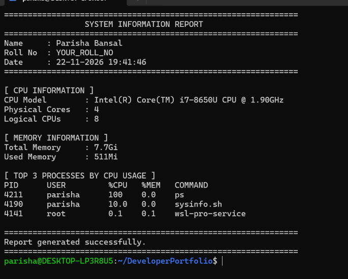

# DeveloperPortfolio

Hi, I'm **Parisha Bansal**. This repository is my developer portfolio assignment. It covers Linux system documentation, shell scripting automation, REST API interaction, and a personal portfolio website.

- **GitHub:** [paribansal3112-hub](https://github.com/paribansal3112-hub)
- **LinkedIn:** [Parisha Bansal](https://www.linkedin.com/in/<your-linkedin-id>)

## Repository Sections

| # | Folder | Description |
|---|--------|-------------|
| 1 | [Linux/](Linux/) | System hardware profile, binary conversion, and Linux command outputs |
| 2 | [ShellScripts/](ShellScripts/) | sysinfo.sh system report and backup.sh folder backup scripts |
| 3 | [API/](API/) | GitHub and JSONPlaceholder API responses with an API summary |
| 4 | [Portfolio/](Portfolio/) | Personal portfolio website |

Screenshots for all tasks are in the [Screenshots/](Screenshots/) folder.

---

## Question 2: Shell Scripting & Automation

### sysinfo.sh Output

### backup.sh Demo
# DeveloperPortfolio
